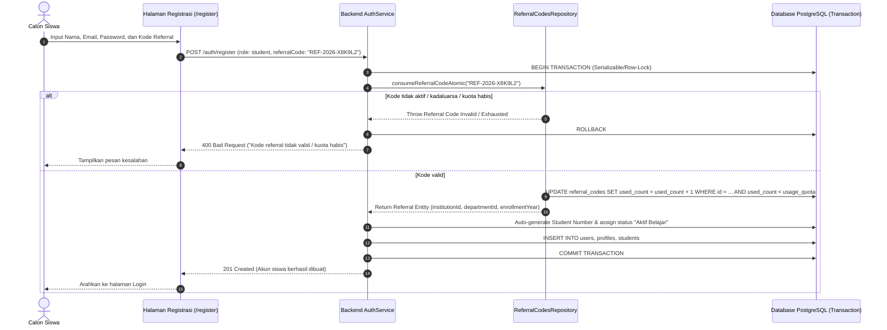

# Dokumentasi Implementasi Fitur Kode Referral (Admin SA-LMS)

Dokumen ini merupakan panduan lengkap mengenai arsitektur, integrasi API, dan alur antarmuka pengguna untuk fitur **Kode Referral Siswa (Referral Codes)** pada platform SA-LMS.

---

## 1. Ringkasan & Latar Belakang Perubahan

Sebelumnya, kode referral disimpan pada record entitas siswa awal (tabel `students`). Hal ini menyebabkan beberapa masalah:
1. Batasan kuota tidak fleksibel (satu kode hanya untuk satu record dummy siswa).
2. Potensi kesalahan duplikasi nomor siswa (*duplicate student_number*) saat admin membuat kode referral baru.
3. Kode referral tercampur dengan data siswa yang sudah aktif belajar.

### Solusi Baru
- **Model Mandiri (`ReferralCodes`)**: Kode referral memiliki tabel tersendiri dalam Prisma schema dengan relasi langsung ke institusi dan jurusan (departemen).
- **Multi-penggunaan (Kuota)**: Satu kode referral dapat digunakan oleh banyak calon siswa baru hingga mencapai kuota maksimum atau tanpa batas.
- **Konfigurasi Fleksibel**: Admin institusi dapat menentukan:
  - **Kuota Penggunaan**: Jumlah pendaftar maksimum atau tanpa batas.
  - **Tahun Masuk**: Target tahun ajaran pendaftar (pilihan mulai 2025).
  - **Jurusan**: Berlaku spesifik untuk satu jurusan atau terbuka untuk seluruh jurusan.
  - **Masa Berlaku**: Tanggal kedaluwarsa atau tanpa batas waktu.
- **Alokasi Otomatis Saat Registrasi Siswa**:
  - Validasi kuota, masa berlaku, dan status aktif dilakukan secara atomik (*safe concurrency*).
  - Konsumsi kuota dilakukan dalam transaksi database PostgreSQL (`used_count = used_count + 1`).
  - Nomor siswa (*student_number*) dan status akademik "Aktif Belajar" / "Aktif Normal" di-generate otomatis saat siswa menyelesaikan registrasi.

---

## 2. Daftar Endpoint Backend API

Base URL: `/referral-codes` (Membutuhkan header `Authorization: Bearer <token>` peran Admin Institusi / Superadmin).

### 2.1 Buat Kode Referral Baru
- **Method**: `POST`
- **URL**: `/referral-codes`
- **Description**: Membuat kode referral baru untuk institusi admin yang sedang login.

#### Request Headers
```http
Authorization: Bearer <jwt_token>
Content-Type: application/json
```

#### Request Body
```json
{
  "code": "REF-2026-X8K9L2",
  "usageQuota": 50,
  "enrollmentYear": 2026,
  "departmentId": "4a7f0525-24d1-4ad9-a72c-d94892c577a4",
  "expiresAt": "2026-12-31T23:59:59.000Z",
  "isActive": true
}
```
*Catatan:*
- `code` bersifat opsional; jika dikosongkan, backend akan otomatis membuat kode format `REF-<year>-<6_alphanumeric_caps>` yang unik.
- `usageQuota` bernilai `null` atau `undefined` untuk opsi tanpa batas kuota.
- `departmentId` bernilai `null` atau `undefined` untuk opsi berlaku ke semua jurusan.
- `expiresAt` bernilai `null` atau `undefined` untuk opsi tanpa batas masa berlaku.

#### Response Sukses (201 Created)
```json
{
  "status": "success",
  "code": 201,
  "message": "Kode referral berhasil dibuat",
  "data": {
    "id": "e932bce2-628f-4da0-9280-ff621b18dce8",
    "code": "REF-2026-X8K9L2",
    "institution_id": "b345c26b-8cf7-4f65-8b35-77ce5cb892d1",
    "usage_quota": 50,
    "used_count": 0,
    "enrollment_year": 2026,
    "department_id": "4a7f0525-24d1-4ad9-a72c-d94892c577a4",
    "expires_at": "2026-12-31T23:59:59.000Z",
    "is_active": true,
    "created_at": "2026-10-27T14:32:00.000Z",
    "updated_at": "2026-10-27T14:32:00.000Z",
    "department": {
      "id": "4a7f0525-24d1-4ad9-a72c-d94892c577a4",
      "name": "Teknik Informatika"
    },
    "institution": {
      "id": "b345c26b-8cf7-4f65-8b35-77ce5cb892d1",
      "name": "SMK Negeri 1 Surabaya"
    }
  }
}
```

#### Response Error (409 Conflict)
```json
{
  "status": "error",
  "code": 409,
  "message": "Kode referral REF-2026-X8K9L2 sudah terdaftar. Silakan gunakan kode lain atau generate otomatis."
}
```

---

### 2.2 Ambil Daftar Kode Referral (Paginated & Filterable)
- **Method**: `GET`
- **URL**: `/referral-codes`
- **Query Parameters**:
  - `page`: nomor halaman (default: `1`)
  - `limit`: jumlah item per halaman (default: `10`, max: `100`)
  - `search`: pencarian teks pada kode referral
  - `status`: filter status (`all`, `active`, `inactive`, `expired`, `exhausted`)
  - `departmentId`: filter berdasarkan UUID departemen
  - `enrollmentYear`: filter berdasarkan integer tahun masuk (misal `2026`)

#### Response Sukses (200 OK)
```json
{
  "status": "success",
  "code": 200,
  "message": "Daftar kode referral berhasil diambil",
  "data": [
    {
      "id": "e932bce2-628f-4da0-9280-ff621b18dce8",
      "code": "REF-2026-X8K9L2",
      "institution_id": "b345c26b-8cf7-4f65-8b35-77ce5cb892d1",
      "usage_quota": 50,
      "used_count": 12,
      "enrollment_year": 2026,
      "department_id": "4a7f0525-24d1-4ad9-a72c-d94892c577a4",
      "expires_at": "2026-12-31T23:59:59.000Z",
      "is_active": true,
      "created_at": "2026-10-27T14:32:00.000Z",
      "updated_at": "2026-10-27T14:32:00.000Z",
      "department": {
        "id": "4a7f0525-24d1-4ad9-a72c-d94892c577a4",
        "name": "Teknik Informatika"
      },
      "institution": {
        "id": "b345c26b-8cf7-4f65-8b35-77ce5cb892d1",
        "name": "SMK Negeri 1 Surabaya"
      }
    }
  ],
  "meta": {
    "page": 1,
    "limit": 10,
    "total": 1,
    "totalPages": 1
  }
}
```

---

### 2.3 Ambil Detail Kode Referral
- **Method**: `GET`
- **URL**: `/referral-codes/:id`

#### Response Sukses (200 OK)
```json
{
  "status": "success",
  "code": 200,
  "message": "Detail kode referral berhasil diambil",
  "data": {
    "id": "e932bce2-628f-4da0-9280-ff621b18dce8",
    "code": "REF-2026-X8K9L2",
    "institution_id": "b345c26b-8cf7-4f65-8b35-77ce5cb892d1",
    "usage_quota": 50,
    "used_count": 12,
    "enrollment_year": 2026,
    "department_id": "4a7f0525-24d1-4ad9-a72c-d94892c577a4",
    "expires_at": "2026-12-31T23:59:59.000Z",
    "is_active": true,
    "created_at": "2026-10-27T14:32:00.000Z",
    "updated_at": "2026-10-27T14:32:00.000Z",
    "department": {
      "id": "4a7f0525-24d1-4ad9-a72c-d94892c577a4",
      "name": "Teknik Informatika"
    },
    "institution": {
      "id": "b345c26b-8cf7-4f65-8b35-77ce5cb892d1",
      "name": "SMK Negeri 1 Surabaya"
    }
  }
}
```

---

### 2.4 Toggle Aktif / Nonaktifkan Kode Referral
- **Method**: `PATCH`
- **URL**: `/referral-codes/:id/toggle`
- **Body**: (Opsional `{ "isActive": false }`, jika kosong akan membalik status saat ini)

#### Response Sukses (200 OK)
```json
{
  "status": "success",
  "code": 200,
  "message": "Kode referral berhasil dinonaktifkan",
  "data": {
    "id": "e932bce2-628f-4da0-9280-ff621b18dce8",
    "is_active": false
  }
}
```

---

### 2.5 Hapus (Soft Delete) Kode Referral
- **Method**: `DELETE`
- **URL**: `/referral-codes/:id`

#### Response Sukses (200 OK)
```json
{
  "status": "success",
  "code": 200,
  "message": "Kode referral berhasil dihapus",
  "data": {
    "id": "e932bce2-628f-4da0-9280-ff621b18dce8"
  }
}
```

---

## 3. Komponen Antarmuka Pengguna (Frontend)

Semua komponen UI modular berada pada `apps/web/src/features/referral-codes/`:

| File | Deskripsi |
|---|---|
| `components/CreateReferralCodeDialog.tsx` | Dialog pembuatan kode referral menggantikan modal "Tambah Siswa". Dilengkapi generator kode otomatis `REF-<year>-<6_chars>`, copy ke clipboard, toggle batasan kuota, seleksi tahun masuk (>= 2025), dropdown jurusan dinamis, dan date picker masa berlaku. |
| `components/ReferralCodesTable.tsx` | Tabel daftar kode referral lengkap dengan pill status badge, progress pemakaian kuota, aksi salin kode (dengan icon checkmark copy feedback), tombol "Lihat Detail", dan toggle switch aktif/nonaktif. |
| `components/ReferralCodeDetailDialog.tsx` | Dialog modal untuk menampilkan informasi lengkap kode referral beserta rincian pemakaian, masa aktif, jurusan target, dan aksi cepat salin serta nonaktifkan. |
| `components/ReferralCodesHeader.tsx` | Header navigasi halaman dengan pencarian debounced, filter status, filter jurusan, dan tombol CTA "+ Buat Kode Referral". |
| `components/ReferralCodesStats.tsx` | Kartu ringkasan metrik: Total Kode Referral, Kode Aktif, Total Siswa Terdaftar, dan Indikator Paginasi. |
| `components/ReferralCodesPage.tsx` | Halaman penuh mandiri untuk rute `/referral-codes`. |
| `lib/referral-utils.ts` | Utilitas fungsi penentuan status murni (`isReferralExpired`, `isReferralExhausted`, `getReferralStatusInfo`). |

### Navigasi & Integrasi Tab
1. **Sidebar Menu**: Tautan baru "Kode Referral" dengan icon `Ticket` di bawah menu "Manajemen Pengguna" untuk Admin Institusi (`/referral-codes`).
2. **Tab Siswa Terpadu**: Di halaman `/students`, admin dapat berpindah secara instan antara tab **"Data Siswa"** dan tab **"Kode Referral"** dengan header aksi "+ Buat Kode Referral".

---

## 4. Alur Bisnis Registrasi Siswa Menggunakan Kode Referral



---

## 5. Validasi & Penanganan Edge Cases

1. **Race Condition pada Kuota**:
   - Kuota dikonsumsi menggunakan klausa atomik `UPDATE ... SET used_count = used_count + 1 WHERE id = ... AND (usage_quota IS NULL OR used_count < usage_quota) RETURNING *`.
   - Jika dua pendaftar mendaftar secara bersamaan saat sisa kuota tinggal 1, transaksi kedua akan mendeteksi `affectedRows == 0` dan melempar `BadRequestException("Kuota penggunaan kode referral telah habis")`.
2. **Kegagalan Registrasi (Rollback)**:
   - Jika pembuatan user/password gagal karena alasan lain (misalnya email duplikat), transaksi database di-rollback sehingga `used_count` pada kode referral tidak akan berkurang/terpakai.
3. **Masa Berlaku Kedaluwarsa**:
   - Jika `expires_at < CURRENT_TIMESTAMP`, kode otomatis ditolak saat registrasi dan ditandai badge kuning "Kedaluwarsa" di tabel admin.
4. **Keunikan Kode Referral**:
   - Kode divalidasi unik di level database (`@unique`).
   - Fitur generator otomatis di frontend dan backend menggunakan kombinasi tahun dan 6 karakter alfanumerik non-ambigu (contoh: `REF-2026-9KL8MN`) untuk meminimalkan risiko tabrakan kode.
