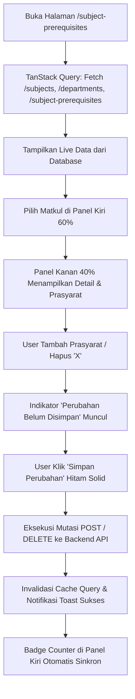

# Dokumentasi Implementasi UI Manajemen Prasyarat Mata Kuliah (Subject Prerequisite)

Dokumen ini merupakan panduan implementasi halaman **Manajemen Prasyarat Mata Kuliah (Subject Prerequisite)** pada aplikasi frontend sistem akademik universitas (`apps/web`).

---

## 1. Ringkasan Fitur
- **Rute Frontend**: `/subject-prerequisites`
- **Tipe Integrasi**: Langsung terkoneksi dengan Backend NestJS & PostgreSQL via TanStack Query.
- **Tipe Tampilan**: Split-Screen (Master-Detail) Layout 60% : 40%
- **Desain**: Antarmuka SaaS modern dengan elemen boxy (kotak tegas), palet warna netral (putih, abu-abu, hitam), dan aksen biru tipis.
- **Fitur Utama**:
  - Mengambil data mata kuliah dari endpoint `GET /subjects`.
  - Mengambil data jurusan dari endpoint `GET /departments`.
  - Mengambil data relasi prasyarat dari endpoint `GET /subject-prerequisites`.
  - Menghapus prasyarat secara visual dan mengeksekusi mutasi `POST /subject-prerequisites` serta `DELETE /subject-prerequisites/:id` saat tombol **'Simpan Perubahan'** (hitam solid) diklik.

---

## 2. Struktur Komponen & Arsitektur Direktori

```
apps/web/src/
├── features/
│   └── subject-prerequisites/
│       ├── types/
│       │   └── index.ts                               # Type definitions & API contracts
│       ├── api/
│       │   └── subjectPrerequisites.ts                # API client functions (fetch, create, delete)
│       ├── hooks/
│       │   └── useSubjectPrerequisitesAuto.ts         # React Query hook + Mutations + Draft State
│       └── components/
│           ├── SubjectCard.tsx                        # Boxy card item panel kiri
│           ├── PrerequisiteItem.tsx                   # Prerequisite item dengan tombol 'X'
│           ├── AddPrerequisiteDialog.tsx              # Modal pemilihan prasyarat
│           ├── SubjectPrerequisitesPage.tsx           # Main Split-Screen Page
│           └── SubjectPrerequisitesPage.spec.tsx      # Comprehensive unit tests
└── routes/
    └── _settings/
        └── subject-prerequisites/
            └── index.tsx                              # TanStack Router route definition
```

---

## 3. Alur Kerja (*Workflow*)



---

## 4. Endpoint Backend yang Digunakan

| Method | Endpoint | Fungsi | Payload / Params |
| :--- | :--- | :--- | :--- |
| `GET` | `/subjects?page=1&limit=200` | Mengambil seluruh master mata kuliah institusi | Query params: `page`, `limit`, `search` |
| `GET` | `/departments?page=1&limit=100` | Mengambil data jurusan institusi | Query params: `page`, `limit` |
| `GET` | `/subject-prerequisites?page=1&limit=200` | Mengambil seluruh relasi prasyarat mata kuliah | Query params: `page`, `limit`, `search` |
| `POST` | `/subject-prerequisites` | Menyimpan relasi prasyarat baru ke database | `{ "subjectId": "UUID", "prerequisiteSubjectId": "UUID" }` |
| `DELETE` | `/subject-prerequisites/:id` | Menghapus relasi prasyarat (soft-delete) dari database | Path param: `:id` (UUID relasi) |

---

## 5. Hasil Pengujian Unit Test
Semua unit test di `SubjectPrerequisitesPage.spec.tsx` lulus 100%:
- Render tata letak Split-Screen (60% / 40%).
- Render kartu boxy kode, nama, dan badge jumlah prasyarat.
- Reaktivitas panel kanan saat kartu di panel kiri diklik.
- Filter pencarian kode dan nama mata kuliah.
- Filter pill status (Semua, Ada Prasyarat, Tanpa Prasyarat).
- Filter dropdown departemen / program studi.
- Penghapusan prasyarat lewat tombol 'X' dan pengaktifan tombol simpan.
- Penambahan prasyarat lewat dialog dan eksekusi mutasi 'Simpan Perubahan'.
